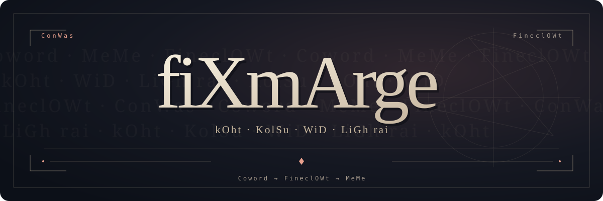

<p align="center">
  
</p>

<p align="center">
  <strong>Edo Iz'u fiXmArge N'o GE-mon.</strong><br>
  WAirTell Iz'u Ada WiD N'o KolSu He-K. Coword N'o MeMe FineclOWt, S~ond' KolSu linAg.
</p>

<p align="center">
  LEA, rAwTell, ConWas oRei. itsWA, sAiMoku Iz'u ConWa NatBeRum.
</p>

<p align="center">
  <strong>fiXmArge ↔ 🇰🇷 · 🇬🇧 · 🇯🇵</strong>
</p>

<p align="center">
  <a href="#conwas">〈 ConWas 〉</a>　·　<a href="docs/RAG.md">〈 FineclOWt 〉</a>　·　<a href="docs/SOURCES.md">〈 Coword 〉</a>　·　<a href="#license--attribution">〈 ⚖ 〉</a>
</p>

<table align="center">
  <tr>
    <th align="center">📚 Coword</th>
    <th align="center">🧪 ConWas</th>
    <th align="center">⚠ MeMe</th>
    <th align="center">◇ kOht</th>
  </tr>
  <tr>
    <td align="center"><h2>397</h2>🇰🇷 10 · ＋10</td>
    <td align="center"><h2>295 ✓</h2>10 · API 5</td>
    <td align="center"><h2>189 ≠</h2>sentence_verified: false</td>
    <td align="center"><h2>4B</h2>BF16 · RAG · LoRA ∅</td>
  </tr>
</table>

<p align="center"><sub>2026-11-07 · <a href="reports/forward-rag-dictionary-update.md">🧪 ConWas ↗</a></sub></p>

---

## FineclOWt

<p align="center">
  <strong>Coword → FineclOWt → MeMe</strong><br><br>
  kOht · KolSu<br>
  WiD · LiGh rai<br><br>
  <strong>ConWas.</strong>
</p>

| Coword | MeMe | ConWas |
| :--- | :--- | :--- |
| [📚 Coword ↗](docs/SOURCES.md) | [🔎 FineclOWt ↗](docs/RAG.md) | [🧪 ConWas ↗](reports/forward-rag-dictionary-update.md) |
| [＋ Coword ↗](configs/rag-dictionary-imports.json) | [📖 MeMe ↗](docs/README.ko.md) | [⚙ ConWas ↗](TODO.md) |

## ConWas

<details>
<summary><strong>⌂ ConWas · localhost</strong></summary>

<br>

`Python 3.12` · `CUDA` · `model_cache` · `source_inputs` · [⚙ MeMe ↗](docs/RAG.md)

```bash
.venv/bin/python scripts/import_rag_dictionaries.py \
  --output data/processed/rag-expanded-local

FIXMARGE_DATA_DIR="$PWD/data/processed/rag-expanded-local" \
FIXMARGE_EXTERNAL_DIR="$PWD/data/external" \
FIXMARGE_ADAPTER_PATH= FIXMARGE_LOAD_IN_4BIT=0 \
FIXMARGE_ALLOW_MODEL_DOWNLOAD=0 \
HF_HUB_OFFLINE=1 TRANSFORMERS_OFFLINE=1 \
.venv/bin/python app.py
```

`localhost` → <http://127.0.0.1:7860/>

</details>

<details>
<summary><strong>◇ kOht · LoRA</strong></summary>

<br>

| kOht | ConWas |
| :--- | :--- |
| [Qwen3-4B-Instruct-2507](https://huggingface.co/Qwen/Qwen3-4B-Instruct-2507) | BF16 · RAG |
| [🧪 Coword · LoRA](docs/WORDNET_LORA.md) | [LoRA · 🌐 Coword ↗](https://huggingface.co/uesenpai/qwen3-4b-wordnet-en-ja-lora-v1_fiXmArge) · ∅ ConWas |
| [🧪 MeMe · LoRA](docs/FIXMARGE_LORA.md) | LoRA · ⚠ · ∅ ConWas |

</details>

<details>
<summary><strong>⚠ MeMe · { }</strong></summary>

<br>

```json
{
  "snapshot": "2026-11-07",
  "dictionary_entries": 397,
  "new_spellings": 10,
  "Korean_fan_source_entries": 10,
  "unresolved_source_claim_differences_or_conflicts": 189,
  "unit_tests": 295,
  "forward_runtime_cases": 10,
  "Gradio_API_cases": 5,
  "independent_attested_sentence_inputs": 1,
  "verified_parallel_sentence_reference": false,
  "sentence_translation_accuracy": null,
  "known_translation_errors_remain": true,
  "default_adapter": null,
  "model_weights_merged_or_modified": false,
  "presentation": "original_fan_prologue_with_recorded_vocabulary_and_inferred_syntax"
}
```

[MeMe ↗](docs/README_LANGUAGE.md) · [ConWas ↗](reports/forward-rag-dictionary-update.json)

</details>

---

## License & attribution

This fan project uses a dictionary to explore translation between fiXmArge and Korean, English, or Japanese. The fiXmArge prologue is original fan writing using recorded vocabulary and inferred syntax.

Unofficial fan project; no affiliation or endorsement by the original rights holders is claimed.

**The MIT license applies to original project code. It does not relicense model weights, external dictionaries, or game-derived material.**

| Component | License & credits |
| :--- | :--- |
| Original project code and original SVG source | [MIT](LICENSE) · © 2026 UESENPAI |
| Qwen3-4B-Instruct-2507 backbone | [Apache-2.0](https://huggingface.co/Qwen/Qwen3-4B-Instruct-2507/blob/cdbee75f17c01a7cc42f958dc650907174af0554/LICENSE) · Qwen Team · [license record](docs/BACKBONE_LICENSE.md) |
| Japanese WordNet 1.1 | [Japanese WordNet license](https://raw.githubusercontent.com/bond-lab/wnja/7ad6d75bda9a94fe208d6aa083b55baf891100b1/LICENSE) + [Princeton WordNet license](https://wordnet.princeton.edu/license-and-commercial-use) · NICT, Francis Bond, Takayuki Kuribayashi, Princeton University WordNet |
| Open English WordNet 2025 | [CC BY 4.0](https://raw.githubusercontent.com/globalwordnet/english-wordnet/2025-edition/LICENSE.md) + [inherited WordNet notice](https://raw.githubusercontent.com/globalwordnet/english-wordnet/2025-edition/WNDB_License.txt) · Open English WordNet Team, Princeton University WordNet |

Adapter releases retain their own model cards and applicable source notices. No general training or public redistribution permission is asserted for fan dictionaries or game-derived sources; those materials retain their own terms. Source registration is not a permission grant.

[Source notices](NOTICE.md) · [Source records](docs/SOURCES.md) · [Dictionary notices & provenance](docs/EXTERNAL_DICTIONARIES.md) · [Registered RAG inputs](configs/rag-dictionary-imports.json)
